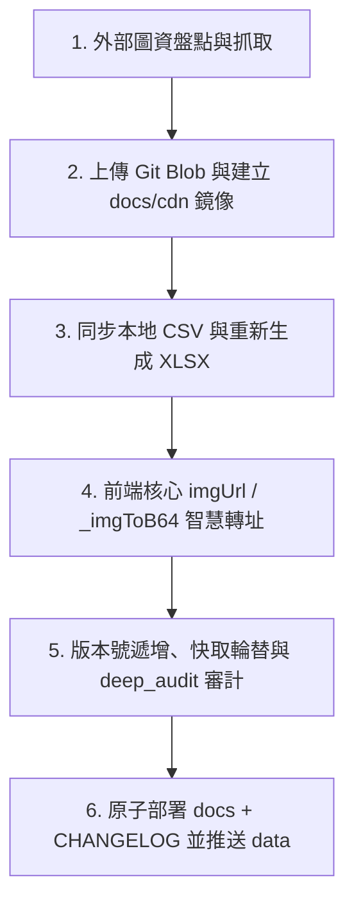

# RetroVault 圖資抓取、本地資料庫備份與 GitHub 建檔部署管線 (Asset Pipeline)

這份 Skill 記錄 RetroVault 專案中將外部圖資（封面、封底、書脊、實機截圖）**從爬取抓圖、鏡像建檔、備份至本地 CSV/Excel，到推上 GitHub 部署**的完整自動化標準作業程序（SOP）。

---

## 為什麼需要自建圖資鏡像管線？（根因與架構）

1. **瀏覽器跨網域安全機制（CORS 同源政策）限制**：
   - App 的「🔄 旋轉 90°」（`lbRotate`、`rotateFieldImg`、`rotateExtraImg`）需將圖片像素繪入 HTML5 `<canvas>` 進行轉繪並重新匯出 Base64 保存。
   - 外部 CDN（如 LaunchBox `images.launchbox-app.com`）未配置 `Access-Control-Allow-Origin: *` 回應標頭。
   - 若瀏覽器直接抓取外部非 CORS 圖片繪入 Canvas，會觸發**受污染畫布（Tainted Canvas）**，在呼叫 `canvas.toDataURL()` 時直接拋出 `SecurityError`，造成「**部分圖片無法旋轉**」的困境。
2. **GitHub Raw 的原生 CORS 支援**：
   - GitHub Raw 節點（`raw.githubusercontent.com`）原生自帶 `Access-Control-Allow-Origin: *`。
   - 將圖資轉存至本地倉庫 `docs/cdn/` 並推上 GitHub 後，前端即可順暢進行 `fetch()`、Canvas 像素運算與無痛旋轉。
3. **資料持久性與防失效**：
   - 第三方圖床或 CDN 可能改版、逾時或 404，自建在 GitHub 倉庫的 `docs/cdn/` 永不失效。

---

## 六大標準作業流程 (Standard Operating Procedure)



---

### 步驟 1：外部圖資盤點與多執行緒爬取（Crawl & Mirror）

1. **掃描來源**：
   掃描 `data/*.csv`、`docs/index.html`（`RETRO_ART_MAP`）、`docs/cyber-museum.html` 與 `docs/3d-viewer.html`，找出所有屬於外部未開放 CORS 之圖源（如 `images.launchbox-app.com`、`gamesdb-images.launchbox.gg`）。
2. **執行緒非同步爬取**：
   - 爬取目標目錄：`docs/cdn/<uuid>.<ext>`。
   - 偽裝標準瀏覽器 `User-Agent`，重試 3 次，確保 HTTP 200 且檔案大小 > 0 bytes。
   - 範例腳本指令：
     ```bash
     python .agents/skills/retrovault-asset-pipeline/scripts/asset_pipeline.py --crawl
     ```

---

### 步驟 2：Git Blob 批次並行上傳與鏡像發布（Blob Upload & Commit）

1. **批次建立 Git Blobs**：
   使用 GitHub Data API（`gh_batch.py` 中的 `create_blob`），透過 `ThreadPoolExecutor(max_workers=8)` 併發建立 Git Blob。
2. **建構 Tree 與單一原子 Commit**：
   將所有 `docs/cdn/<filename>` 封裝在同一次 Commit 中推送至 `main` 分支。
3. **官方發布節點格式**：
   `https://raw.githubusercontent.com/Kevinte67228/Retro-library/main/docs/cdn/<filename>`
   - 範例腳本指令：
     ```bash
     $env:GH_TOKEN="<token>"; python .agents/skills/retrovault-asset-pipeline/scripts/asset_pipeline.py --upload
     ```

---

### 步驟 3：本地資料庫與 Google 試算表匯入檔無縫同步（Data Sync）

1. **更新本機 CSV**：
   - `data/RetroVault_遊戲_FC.csv`
   - `data/RetroVault_遊戲_MD.csv`
   - `data/RetroVault_GS_Games_全量匯入檔.csv`
   將欄位中的外部 CDN 網址全部批次替換為自建的 `https://raw.githubusercontent.com/Kevinte67228/Retro-library/main/docs/cdn/<filename>`。
2. **全量重新生成 XLSX 匯入檔**：
   - 必須使用 `openpyxl` 將 `data/RetroVault_GS_Games_全量匯入檔.csv` 完整 57 欄位結構同步寫入 `data/RetroVault_GS_Games_全量匯入檔.xlsx`。
   - 嚴禁只更新 CSV 而遺漏 XLSX，保持資料雙向一致。
   - 範例腳本指令：
     ```bash
     python .agents/skills/retrovault-asset-pipeline/scripts/asset_pipeline.py --sync-db
     ```

---

### 步驟 4：前端核心引擎自動轉址防禦（Auto Rewrite）

為確保使用者的歷史自訂試算表中若含有舊版網址時依然能無感享有自建圖庫與旋轉功能，前端必須內建防禦性轉址：

1. **`imgUrl(v, sz)` 轉址**：
   ```javascript
   if(v.indexOf('images.launchbox-app.com/')>=0){
     v=v.replace('https://images.launchbox-app.com/','https://raw.githubusercontent.com/Kevinte67228/Retro-library/main/docs/cdn/');
   }
   if(v.indexOf('gamesdb-images.launchbox.gg/')>=0){
     v=v.replace('https://gamesdb-images.launchbox.gg/','https://raw.githubusercontent.com/Kevinte67228/Retro-library/main/docs/cdn/');
   }
   ```
2. **`_imgToB64(src)` 轉址**：
   在執行 `fetch(src, {mode:'cors'})` 前，優先將 LaunchBox 網址替換為 GitHub Raw 官方源，確保 fetch 成功且獲得 `Access-Control-Allow-Origin: *`，使 Canvas 旋轉 90° 順暢執行。
3. **同步修正子頁面**：
   - `docs/cyber-museum.html`（`DEMO_COLLECTION` 與 `RETRO_ART_MAP`）
   - `docs/3d-viewer.html`（`SAMPLE_GAMES`）
   - `docs/js/vault-db.js`

---

### 步驟 5：版本維護與全合規審計（Audit）

1. **版本號管理**：
   - 主程式 [docs/index.html](file:///d:/RetroVault_App/docs/index.html) 三處同步更新：
     - `#app-ver`
     - `#app-ver2`
     - `const APP_VERSION = 'vXX.YY'`
   - 複製版本獨立檔：`docs/RetroVault_vXX_YY_index.html`。
2. **Service Worker 快取更動**：
   - [docs/sw.js](file:///d:/RetroVault_App/docs/sw.js)：`const CACHE_NAME = 'retrovault-vXX-YY'`。
   - 更新 `STATIC_ASSETS`（加入最新版，移除最舊版，保持最新 5 版）。
3. **更新部署保護清單**：
   - [docs/_internal/github_deploy.py](file:///d:/RetroVault_App/_internal/github_deploy.py) 的 `PROTECTED_DOCS_VERSIONS`。
4. **執行嚴格合規檢查**：
   ```bash
   python _internal/deep_audit.py
   ```
   *必須保證 6 大檢查項（資產路徑、ID唯一性、版本號一致性、原生對話框審查）全數綠燈通過。*

---

### 步驟 6：雙 Commit 原子部署與發布（Deploy & Push）

1. **撰寫更新日誌**：
   在 [_internal/CHANGELOG.md](file:///d:/RetroVault_App/_internal/CHANGELOG.md) 最頂部加入當前版本的詳細變更紀錄。
2. **Commit 1：部署前端與說明文件**：
   ```powershell
   $env:GH_TOKEN="<token>"; python _internal/github_deploy.py vXX_YY docs _internal/CHANGELOG.md
   ```
   *此腳本自動完成當前版本備份、docs 部署、舊版輪替清理與觸發 GitHub Pages 建置。*
3. **Commit 2：推送本地實體資料庫更新**：
   ```powershell
   $env:GH_TOKEN="<token>"; python -c "
   import sys; sys.path.insert(0, '_internal')
   from gh_batch import batch_commit
   files = ['data/RetroVault_遊戲_FC.csv', 'data/RetroVault_遊戲_MD.csv', 'data/RetroVault_GS_Games_全量匯入檔.csv', 'data/RetroVault_GS_Games_全量匯入檔.xlsx']
   adds = {p.replace('\\\\', '/'): open(p, 'rb').read() for p in files}
   batch_commit('data: 更新實體資料庫與匯入檔', adds=adds)
   "
   ```
4. **線上驗證**：
   隨機抽取一筆自建 CDN 圖片網址，檢查 HTTP 狀態碼為 200 且回應標頭帶有 `Access-Control-Allow-Origin: *`。

---

## 自動化工具指令速查 (CLI Cheat Sheet)

```bash
# 1. 僅掃描專案中存在的外部無 CORS 圖資數量
python .agents/skills/retrovault-asset-pipeline/scripts/asset_pipeline.py --scan

# 2. 爬取外部圖資至 docs/cdn/
python .agents/skills/retrovault-asset-pipeline/scripts/asset_pipeline.py --crawl

# 3. 批次替換本地 CSV 並全量重建 Excel
python .agents/skills/retrovault-asset-pipeline/scripts/asset_pipeline.py --sync-db

# 4. 上傳圖檔至 GitHub 倉庫 docs/cdn/
$env:GH_TOKEN="<token>"; python .agents/skills/retrovault-asset-pipeline/scripts/asset_pipeline.py --upload

# 5. 一鍵執行全流程 (爬取 -> 資料庫同步 -> GitHub 上傳)
$env:GH_TOKEN="<token>"; python .agents/skills/retrovault-asset-pipeline/scripts/asset_pipeline.py --all
```
