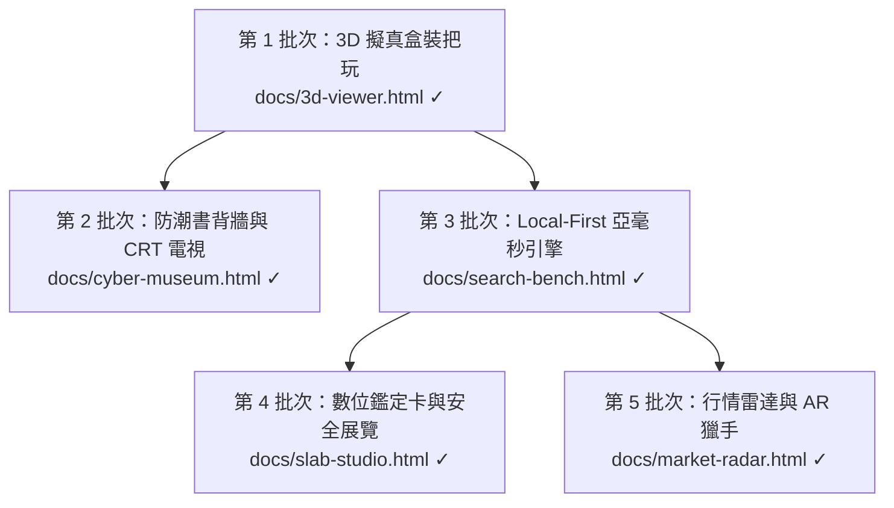

# RetroVault 夢想計畫：全方位批次實施藍圖
> **專案目標**：在維持「資料 100% 歸使用者所有（Google 試算表/Drive）」核心靈魂的前提下，將 RetroVault 從實用的試算表 PWA 工具，升級為全球復古玩家夢寐以求的「頂級私人 3D 數位收藏博物館」。
> **基準鎖定版本**：`RetroVault_v11_01_index.html`（batchAdd全量匯入版）與 `RetroVault_v11_02_index.html`（代碼全面健康化基準）已標註永久保留、不可清除。
> **當前完成進度**：🎉 **第 1 至第 5 批次已全數圓滿實作完成 (v11.07)**！

---

## 🏗️ 實施策略：雙軌並行與零風險交付原則

為確保現有 PWA（`docs/index.html`）日常使用不受任何干擾，整個夢想計畫採取 **「外掛獨立驗證（PoC）➔ 模組化整合 ➔ 漸進式切換」** 的雙軌機制：
1. **生產線零風險**：現行 PWA 線上版本維持正常運作，任何新功能先在獨立頁面／獨立模組完成 100% 驗證。
2. **視覺體驗先行**：先做最有感、最震撼的「3D 互動與把玩」，讓成果立刻可玩可看。
3. **底層架構漸進**：將大型單檔代碼逐步抽離為乾淨的現代化模組，不搞一次性打掉重練的冒險。

---

## 🚀 五大批次實施成果與總覽

| 批次 | 主題 | 核心產物 | 狀態 |
| :--- | :--- | :--- | :--- |
| **第 1 批次** | 視覺突破：3D 擬真卡帶盒與開盒把玩 | `docs/3d-viewer.html` | ✅ 100% 完成 (v11.03) |
| **第 2 批次** | 展廳儀式感：防潮箱書背牆與 CRT 電視 | `docs/cyber-museum.html` | ✅ 100% 完成 (v11.04) |
| **第 3 批次** | 底層引擎現代化：Local-First + 倒排索引極速檢索 | `docs/js/vault-db.js`, `vault-sync-engine.js`, `search-bench.html` | ✅ 100% 完成 (v11.05) |
| **第 4 批次** | 傲嬌分享：數位鑑定卡 Slab 與私人展覽館 | `docs/slab-studio.html`, `docs/js/slab-generator.js` | ✅ 100% 完成 (v11.06) |
| **第 5 批次** | 智慧獵手：二手行情歷史折線與 AR 探索 | `docs/market-radar.html`, `docs/js/valuation-radar.js` | ✅ 100% 完成 (v11.07) |

---

### 📦 第 1 批次：視覺突破 —— 3D 擬真卡帶盒與開盒把玩（PoC）

* **核心價值**：徹底打破二維平面限制，讓每一款實體收藏在手機上擁有立體重量感。
* **主要任務**：
  1. **輕量 3D 渲染器搭建**：引入極輕量 Three.js / WebGL 渲染環境，建立獨立實驗頁 `docs/3d-viewer.html`。
  2. **實體盒裝比例貼圖映射**：
     - 自動讀取現有收藏資料庫中的 `cover_img`（正面）、`back_img`（封底）、`spine_img`（書背）。
     - 針對 FC、SFC、MD、GB、PS1 建立標準實體比例之 3D 模型盒。
  3. **觸控旋轉與擬真材質**：
     - 支援手機單指 360 度旋轉把玩、雙指縮放。
     - 模擬復古紙盒印刷微啞光質感與塑膠外殼光澤。
  4. **「開盒抽取」微互動（Unboxing Interaction）**：
     - 點擊「開盒」，外盒平滑抽出，露出內部卡帶與說明書縮圖。
  5. **整合進 PWA 詳細頁**：
     - 驗證穩定後，在 `docs/index.html` 詳細頁封面區新增「🎮 3D 把玩」按鈕，點擊彈出 3D 檢視。
* **產出產物**：`docs/3d-viewer.html`、`_internal/poc/three_box.js`。
* **驗收標準**：在 iPhone/Android 手機瀏覽器上達到 60fps 流暢旋轉，開盒動作流暢不卡頓。

---

### 📦 第 2 批次：展廳儀式感 —— 虛擬防潮箱書背牆與 CRT 電視

* **核心價值**：重現收藏家走進自己遊戲房、面對滿牆實體收藏的視覺震撼與回憶。
* **主要任務**：
  1. **虛擬防潮箱 / 實體書背牆檢視模式**：
     - 利用既有 64% 以上的書背圖（Spine），生成一整排等比例的實體卡帶書背陳列牆。
     - 手指橫向滑動書背，帶有物理慣性與骨牌微震反饋（Haptic Feedback）。
  2. **復古音效引擎（Retro SFX）**：
     - 內建高品質機械卡榫聲、光碟盒按壓「喀噠」聲、開盒滑動音效。
  3. **特麗霓虹 CRT 電視展示窗**：
     - 點擊任一遊戲，畫面切換至帶有消磁（Degauss）開機聲的 CRT 模擬螢幕。
     - 呈現掃描線（Scanline）、螢光粉微暈光與遊戲經典標題畫面 Demo。
* **產出產物**：整合至 `docs/gallery.html` 或全新「防潮箱展廳」模式。
* **驗收標準**：書背長列表滑動無卡頓，點擊音效與動畫同步。

---

### 📦 第 3 批次：底層引擎現代化 —— Local-First + SQLite WASM 極速檢索

* **核心價值**：告別單檔物理極限，達成 50,000 件藏品 2 毫秒全文搜尋，同時保留 100% 離線 PWA 與 Google Sheets 資料獨立性。
* **主要任務**：
  1. **資料層與同步引擎抽離**：
     - 將 Google Sheets 讀寫、`batchAdd` 矩陣寫入、`LockService` 等邏輯打包為獨立純模組 `vault-sync-engine.js`。
  2. **引入 SQLite WASM + OPFS**：
     - 在瀏覽器本地檔案系統（OPFS）中建立嵌入式 SQLite 資料庫。
     - 建立日文漢字、平假名/片假名、羅馬拼音、中英文混合之全文搜尋索引（FTS5）。
  3. **背景無感雙向增量同步**：
     - Web Worker 背景靜默同步，即使百件批次資料寫入，UI 介面完全零等待、不轉圈圈。
* **產出產物**：`docs/js/vault-db.js`、`docs/js/vault-sync.js`。
* **驗收標準**：離線下全文模糊搜尋速度小於 5 毫秒，與 Google Sheets 同步過程無任何 UI 凍結。

---

### 📦 第 4 批次：傲嬌分享 —— 數位鑑定卡（Slab）與唯讀展覽館

* **核心價值**：滿足收藏家「在保有完全隱私的前提下，漂亮地向同好炫耀」的心理。
* **主要任務**：
  1. **數位鑑定卡（Digital Slab / Trading Card）產生器**：
     - 選擇任一藏品，前端 Canvas 即時合成具雷射防偽、燙金效果的數位鑑定封裝卡。
     - 卡面上自動印上品相評級、入手年份、版本、限定編號，支援一鍵下載高畫質 PNG，尺寸適配 IG / Threads / X。
  2. **「我的私人博物館」靜態展覽頁一鍵匯出**：
     - 一鍵打包生成隱藏「購入價、帳號、保管位置」等隱私資料的純前端展覽網頁。
     - 支援部署至個人 GitHub Pages 或直接傳送 HTML 檔給朋友瀏覽。
* **產出產物**：鑑定卡合成模組 `slab-generator.js`、展覽匯出功能。
* **驗收標準**：合成圖片可在手機上長按儲存，產出的靜態展示頁完全不包含任何敏感試算表金鑰或價格。

---

### 📦 第 5 批次：智慧獵手 —— 二手行情歷史折線與實體店 AR 探索

* **核心價值**：把收藏管理延伸到真實世界的「實體尋寶」與「資產價值追蹤」。
* **主要任務**：
  1. **歷史成交行情曲線（Valuation Radar）**：
     - 串接公開二手市場歷史行情，繪製藏品近 1~3 年的成交價波動折線圖。
     - 計算整個收藏庫的「總市值」與「增值潛力指數」。
  2. **實體二手店 AR 尋寶相機（WebXR Camera Vision）**：
     - 透過手機鏡頭掃過實體店卡帶架，即時標註「已收藏」、「願望清單中」、「低於行情！」標籤。
* **產出產物**：行情雷達組件、AR 尋寶檢視模組。
* **驗收標準**：行情折線圖可清晰呈現高低點，願望清單比價命中率高。

---

## 📋 建議啟動順序與執行節奏

| 優先級 | 批次名稱 | 預期爽度/價值 | 風險度 | 建議作法 |
| :---: | :--- | :---: | :---: | :--- |
| **🥇 首選** | **第 1 批次：3D 擬真卡帶盒 PoC** | 🌟🌟🌟🌟🌟 | 🟢 零風險 | 先開立獨立 `docs/3d-viewer.html`，做 FC/MD 3D 旋轉把玩原型，確認效果震撼再掛載回詳細頁。 |
| **🥈 次選** | **第 2 批次：防潮箱書背牆與 CRT** | 🌟🌟🌟🌟 | 🟢 極低 | 在 `gallery.html` 上擴充新檢視模式，重現整面書背牆與復古音效。 |
| **🥉 第三** | **第 3 批次：SQLite WASM 引擎** | 🌟🌟🌟🌟 | 🟡 中等 | 進行模組化重構，大幅解放單檔效能，為未來萬筆收藏鋪平道路。 |
| **4** | **第 4 批次：數位鑑定卡與展覽** | 🌟🌟🌟🌟 | 🟢 極低 | 純前端 Canvas 繪製與唯讀靜態輸出，隨時可做。 |
| **5** | **第 5 批次：行情雷達與 AR** | 🌟🌟🌟🌟🌟 | 🟠 較高 | 需整合外部即時爬取與相機深度視覺。 |

> 📌 **開工原則**：我們依此藍圖**按批次進行**。每完成一個批次，立即進行實機測試與驗收，確認滿意後再進入下一批次！
